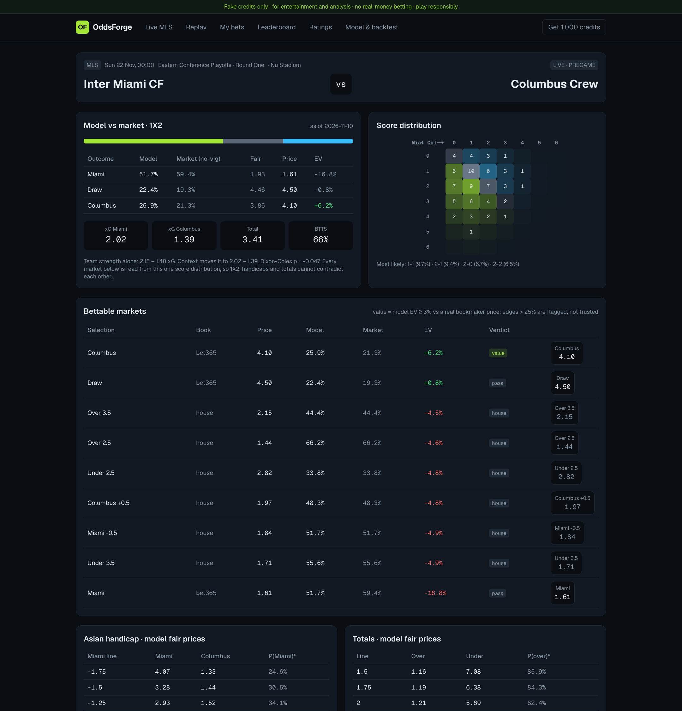
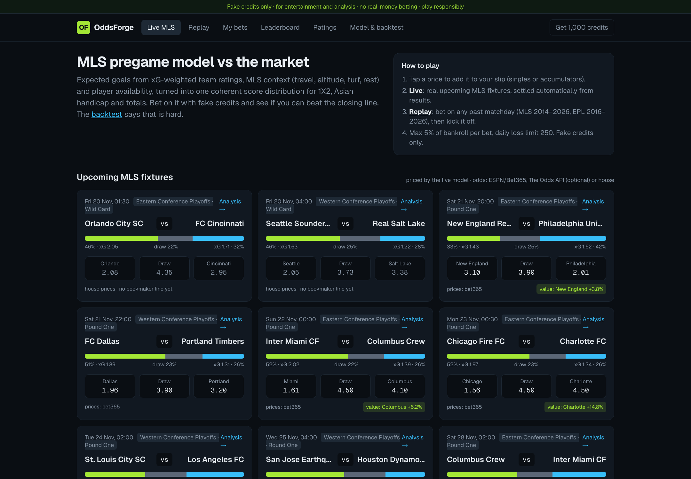
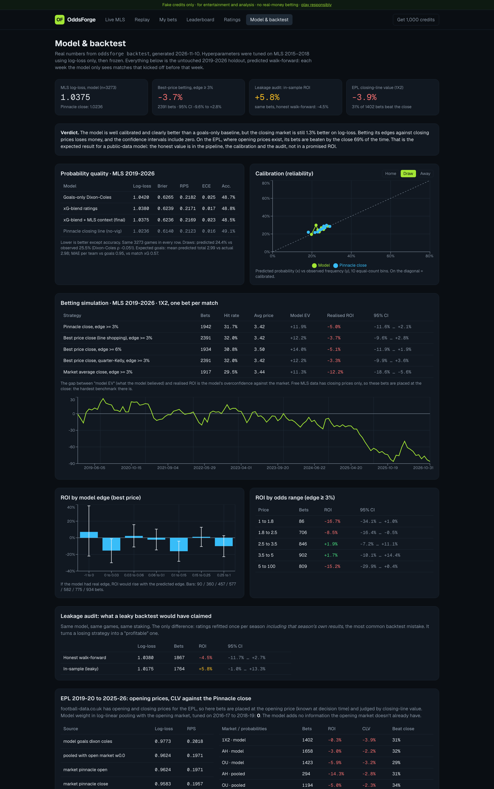
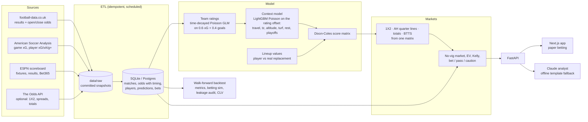

# OddsForge: MLS pregame model, honest backtests, fake-money betting

**A pregame soccer prediction system for MLS: xG-weighted team ratings, MLS-specific context, player-availability
adjustments and a Dixon-Coles score distribution that prices 1X2, Asian handicaps, totals and BTTS coherently. A
market layer compares it with real bookmaker prices, a walk-forward backtest reports what it would really have
done, and a web app lets people play it with fake credits.**

It runs on real data: 6,300+ MLS matches (2012–2026) with closing odds, game-level xG for 5,988 of them, player
xG/xA/goals-added, 4,180 EPL matches with opening *and* closing 1X2/AH/O-U prices, and the live MLS playoff
fixtures from ESPN. No API key is needed: everything is bundled, and the optional keys (Claude, The Odds API) only add features.



> **Fake credits only.** OddsForge is an analysis tool and a game. No deposits, no payouts, no bookmaker links.
> The backtest below shows that the model does **not** beat the closing line. That result is reported, not hidden.

---

## Results (real numbers, holdout seasons)

Hyperparameters were tuned on **MLS 2015–2018 using log-loss only** (45 combinations), then frozen. Everything below
is the untouched **2019–2026** holdout, predicted walk-forward: every week the model is refitted on matches that
kicked off *before* that week, and nothing else. Generated by `oddsforge backtest` (≈100 s on a laptop); the full
report is [`data/reports/backtest.json`](data/reports/backtest.json) and the app's *Model & backtest* page.

### Probability quality: MLS 2019–2026, same 3,273 games in every row

| Model | Log-loss | Brier | RPS | ECE | Accuracy |
| --- | ---: | ---: | ---: | ---: | ---: |
| Goals-only Dixon-Coles (baseline) | 1.0420 | 0.6265 | 0.2182 | 0.025 | 48.7% |
| xG-blend ratings (60% xG / 40% goals) | 1.0380 | 0.6239 | 0.2171 | 0.017 | 48.8% |
| **xG-blend + MLS context (final)** | **1.0375** | **0.6236** | **0.2169** | 0.023 | 48.5% |
| Pinnacle closing line, vig removed | 1.0236 | 0.6140 | 0.2123 | 0.016 | 49.1% |

- xG helps: replacing goals with a 60/40 xG/goals target is the single biggest gain. The context model adds a little more log-loss gain; its calibration (ECE) is slightly worse than xG-only.
- The closing market is still **1.3% better on log-loss**. A public-data model is not expected to beat it, and this one doesn't.
- Expected goals are unbiased: mean predicted total 2.99 vs 2.98 actual. Draws are slightly under-predicted (24.4% vs 25.5% observed, Dixon-Coles ρ = −0.051).

### Betting simulation: MLS 2019–2026, 1X2, one bet per match

| Strategy | Bets | Avg price | Model's own EV | **Realised ROI** | 95% CI (bootstrap) |
| --- | ---: | ---: | ---: | ---: | --- |
| Pinnacle close, edge ≥ 3% | 1,942 | 3.42 | +11.9% | **−5.0%** | −11.6% … +2.1% |
| Best price close (line shopping), edge ≥ 3% | 2,391 | 3.42 | +12.2% | **−3.7%** | −9.6% … +2.8% |
| Best price close, edge ≥ 6% | 1,934 | 3.50 | +14.0% | **−5.1%** | −11.9% … +1.9% |
| Best price close, quarter-Kelly, edge ≥ 3% | 2,391 | 3.42 | +12.2% | **−3.3%** | −9.9% … +3.6% |
| Market-average close, edge ≥ 3% | 1,917 | 3.44 | +11.3% | **−12.2%** | −18.6% … −5.6% |

The model *believed* its bets were worth +12%. They lost 4–5%. That gap is overconfidence against an efficient
market, mostly on longshots. ROI does not rise with the predicted edge, which is the signature of no real edge:

| Model edge | 0–3% | 3–6% | 6–10% | 10–15% | 15–25% | > 25% |
| --- | ---: | ---: | ---: | ---: | ---: | ---: |
| Bets | 360 | 457 | 577 | 582 | 775 | 934 |
| ROI | −15.4% | +2.2% | −2.3% | −16.1% | +1.2% | −10.0% |

Free MLS data only has **closing** odds, so these bets are placed at the close: the hardest benchmark, and no CLV is
possible there. For that, see the EPL section.

### Leakage audit: what a leaky backtest would have claimed

Same model, same games, same staking. The only change is that ratings are refitted once per season *including that
season's own results*, the most common backtest mistake:

| | Log-loss | Bets | ROI | 95% CI |
| --- | ---: | ---: | ---: | --- |
| Honest walk-forward | 1.0380 | 1,867 | **−4.5%** | −11.7% … +2.7% |
| In-sample (leaky) | 1.0175 | 1,764 | **+5.8%** | −1.0% … +13.3% |

A ten-point ROI swing, and a log-loss that "beats" Pinnacle, from one line of leakage. `tests/test_models.py`
guards against it: tampering with every result after date T must leave a rating fitted at T unchanged.

### EPL 2019/20–2025/26: bet at the open, judge by closing-line value

football-data.co.uk has opening and closing prices for the EPL, so here the bets use the **opening** Pinnacle price
(available at decision time) and are scored by CLV against the **closing** Pinnacle price, vig removed.

| Market (model probabilities) | Bets | ROI | 95% CI | Mean CLV | Bets that beat the close |
| --- | ---: | ---: | --- | ---: | ---: |
| 1X2 | 1,402 | −0.4% | −10.5% … +9.7% | −3.9% | 30.5% |
| Asian handicap | 1,658 | −3.1% | −7.4% … +1.2% | −2.2% | 32.3% |
| Over/Under 2.5 | 1,423 | −6.0% | −11.3% … −0.8% | −3.2% | 29.1% |

Log-loss: model 0.9773, Pinnacle open 0.9624, Pinnacle close 0.9583. When model and opening market are pooled
log-linearly in expected-goals space (weight tuned on 2016–2019), the best model weight is **0.0**: the opening
market already contains everything this model knows. Negative CLV on roughly 70% of bets says the same thing more
quickly than ROI can. ROI on 1,400 bets has a ±10-point interval; CLV converges much faster.

**What this means:** the pipeline, the probability maths and the audit are solid. A profitable edge would need
information the market does not price fast enough: timestamped lineups and injury news, opening prices, player
tracking data. The architecture has a slot for each (see *Known gaps*).

---

## The app

| | |
| --- | --- |
|  |  |

- **Live MLS:** real upcoming fixtures (currently the 2026 playoffs) priced by the live model, with Bet365 prices from ESPN, multi-book prices from The Odds API when a key is set, or clearly labelled *house* prices (model + 5% margin) when no bookmaker has a line yet. Bets settle automatically when ESPN reports the result.
- **Replay:** bet on any past matchday (MLS 2014–2026, EPL 2016–2026) using the walk-forward prediction made the week before and real closing odds, then *kick off* to reveal the scores and settle. Practice only; it never counts on the live leaderboard.
- **Match page:** model vs no-vig market, EV and a bet/pass/caution verdict for every selection, the score-distribution heat map, Asian handicap and totals ladders, SHAP context effects, player-availability toggles, last-5 form with xG, head to head, and the AI analyst.
- **Bet slip:** singles and accumulators (max 6 legs, one leg per match), server-side prices, model EV of the slip.
- **My bets, Leaderboard, Ratings:** P&L curve, ROI split live/replay, power ratings with xG for/against.
- **Responsible play:** max 5% of bankroll per bet, 250-credit daily loss limit, pregame only, no bonuses or streaks, help lines.

---

## How the model works



**1. Team strength.** `log E[goals] = μ + home + attack_i − defence_j`, fitted by weighted Poisson likelihood with
L2 shrinkage towards league average (a Bayesian prior in disguise, which tames small samples and gives expansion
clubs a sensible slightly-below-average start). The target is 60% xG + 40% goals: goals carry finishing and
goalkeeping noise, but pure xG ignores penalties and real finishing skill. Matches are weighted with a 240-day
half-life, so form matters without four lucky wins overturning a season. Ratings are opponent-adjusted by construction.

**2. MLS context (stage 2).** A LightGBM Poisson model uses the stage-1 log-rate as its offset, so it can only learn
what ratings miss: away travel distance (Vancouver to Miami is about 4,500 km), time-zone shift, altitude in
Colorado and Salt Lake, artificial turf, rest and congestion, playoff knockout games, season phase and
cross-conference trips. It is retrained each season on **out-of-sample** stage-1 predictions only. SHAP values
explain every adjustment on the match page.

> An audit story from building it: raw stadium altitude in metres gave almost every stadium a unique value, so the
> trees used it as a **hidden team identifier**. Miami's 3 m picked up +13% xG from Miami's recent high-scoring home
> games, double-counting strength the ratings already had. Altitude is now "km above 1,000 m": zero everywhere
> except the two places where it actually matters.

**3. Player availability.** Losing Messi is not `injured_players = 1`. Each player is valued against the specific
player who replaces him (the next player at his position on the same roster, regressed towards league replacement
level when the backup has little evidence), on xG+xA per 90 (attack), goals-added from interrupting and fouling
(defence) and shot-stopping per shot (goalkeepers, heavily shrunk). The loss is scaled by how often he normally
plays, because the team rating already contains his usual absences. Examples from the 2026 data: **Messi out: −19%
of Miami's expected goals** (vs Silvetti); **Matt Turner out: +0.18 goals conceded** for New England.

**4. Score distribution.** Independent Poisson with the Dixon-Coles low-score correction (ρ fitted by maximum
likelihood on earlier seasons). Every market is read from that one matrix, so P(draw) is the diagonal, AH −0.5 is
exactly the home-win probability and DNB is exactly the AH 0 line. There is no separate 1X2 classifier to contradict
the goal model.

**5. Market layer.** Vig removal by the power method (multiplicative, additive and Shin are implemented and tested;
the naive method inflates longshots and produces fake value). Asian handicap settlement handles quarter lines
(half win / half loss). EV handles pushes correctly. Fractional Kelly is capped. Edges above 25% are labelled
*caution*, because in a mature market they usually mean the model is missing news.

### What must be timestamped (and what this project can and cannot do)

| Information | Here | Used in backtest? |
| --- | --- | --- |
| Results, xG | after the match | only for matches before the decision week |
| Closing odds (MLS, EPL) | `timing = close` | only as the *price* we bet at or are judged against, never as a feature |
| Opening odds (EPL) | `timing = open` | decision price; also the market prior in pooling |
| Live odds snapshots | `timing = snapshot`, `captured_at` | live play |
| Schedule (rest, travel, playoffs) | published in advance | yes |
| Player season stats, absences | season-to-date aggregates | **no**: no timestamped historical lineups in free data, so live only |

### Known gaps (what a production version needs)

- Timestamped lineups, injuries and suspensions, so player availability can be backtested honestly (Opta, Sportradar, or scraped team-news feeds with capture time).
- MLS opening and intraday odds, for CLV and line-movement features.
- The full club calendar (CONCACAF Champions Cup, Leagues Cup, U.S. Open Cup) for rest and congestion; the free data covers league games only.
- A diagonal-inflation term or bivariate Poisson for the 1.1-point draw under-prediction.
- Goalkeeper and set-piece models; xG with penalties split out (npxG).

---

## Quick start

Requirements: Python 3.11+, Node 20+. No API keys.

```bash
git clone https://github.com/sibrahimpa1/oddsforge.git && cd oddsforge
```

```bash
cd backend && python -m venv .venv && . .venv/bin/activate && pip install -e ".[dev]"
```

```bash
oddsforge all
```

```bash
oddsforge serve
```

```bash
cd web && npm install && npm run dev
```

Open http://localhost:3000. `oddsforge all` builds the database from the bundled raw data and runs the full
backtest (about 2–3 minutes). Other commands: `oddsforge fetch` (re-download every source), `oddsforge refresh`
(fixtures, results and odds only, then settle bets), `oddsforge backtest`.

With Docker:

```bash
docker compose up --build
```

### Optional keys (`.env`, see `.env.example`)

| Key | Adds |
| --- | --- |
| `ANTHROPIC_API_KEY` | Claude (`claude-opus-5-5`) writes the match analysis from the model's fact sheet. Without it, a deterministic template uses the same facts. |
| `ODDS_API_KEY` | Multi-book 1X2, spreads and totals for upcoming MLS games from The Odds API. Without it, live prices come from ESPN (Bet365 1X2) or the labelled house book. |

### Tests

```bash
cd backend && pytest -q && ruff check oddsforge tests
```

43 tests cover vig removal (power and Shin keep the order and take more margin from longshots), Asian handicap
quarter-line settlement (including a zero-sum check over every score and line), score-matrix coherence (AH 0 equals
DNB, fair prices give zero EV), recovery of known ratings and ρ from simulated leagues, the no-look-ahead guarantee,
and the paper-betting rules (server prices, stake and daily-loss limits, accumulator settlement, replay reveal).
CI runs them plus a no-network ETL smoke test and the production web build.

## Project layout

```
backend/oddsforge/
  etl/          sources.py (downloads), load.py (raw -> DB, idempotent)
  model/        ratings.py, context.py, engine.py (walk-forward), dixon_coles.py, lineup.py
  markets/      odds.py (vig, EV, Kelly, CLV), settlement.py (AH/totals), derive.py (markets from the matrix)
  backtest/     metrics.py, betting.py, report.py (tuning, holdout, audit, EPL CLV)
  betting/      service.py (fake-money accounts, slip, settlement, leaderboard)
  service.py    point-in-time predictions, prices, value rows
  analyst.py    Claude analyst + offline fallback
  api.py        FastAPI
web/            Next.js 15 + Tailwind + Recharts
data/raw/       committed source snapshots (≈11 MB), data/reports/backtest.json
```

## Data sources and terms

- [football-data.co.uk](https://www.football-data.co.uk): results and betting odds, free for non-commercial use.
- [American Soccer Analysis](https://www.americansocceranalysis.com) public API: MLS xG, xA and goals added.
- ESPN public scoreboard: fixtures, results and the Bet365 1X2 line shown on ESPN.
- [The Odds API](https://the-odds-api.com) (optional, your own key).

If gambling is causing you harm: US 1-800-GAMBLER, UK GamCare 0808 8020 133.

## Author

Built by Senka Ibrahimpašić ([@sibrahimpa1](https://github.com/sibrahimpa1)).

## License

MIT, see [LICENSE](LICENSE).
